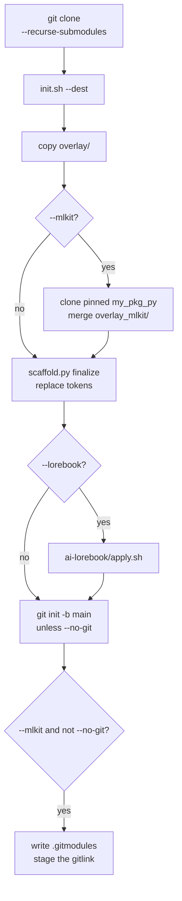

# init.sh

`init.sh` copies `overlay/` into an empty directory, replaces placeholders, and optionally adds mlkit or AI editor rules.

```bash
./init.sh --dest PATH [--name NAME] [--python VERSION]
           [--mlkit] [--lorebook] [--https] [--no-git]
```

## Flags

| Flag | Meaning |
| --- | --- |
| `--dest PATH` | New project directory. Required. Created if missing. Must be empty if it already exists. |
| `--name NAME` | Project name. Default: the destination directory's basename. |
| `--package PKG` | Override the import package. Default: replace `-` and `.` in `NAME` with `_`. |
| `--python VERSION` | Python version. Default: `3.12`. |
| `--mlkit` | Clone the pinned `my_pkg_py` submodule into `pkgs/` and scaffold the training pipeline. Unless `--no-git`, register that checkout as a submodule of the new project. |
| `--lorebook` | Copy Cursor, Copilot, and Claude rules. Off by default. |
| `--https` | Use HTTPS for the `pkgs/my_pkg_py` origin and, when the submodule is registered, for the `.gitmodules` URL. Also applied when this template's `origin` is already `http://` or `https://`. |
| `--no-git` | Do not run `git init` in the destination. With `--mlkit`, the pin is not recorded. |
| `-h`, `--help` | Print the comment help and exit. |

## Names

- Project name: starts and ends with a letter or digit. The middle may also contain `.`, `_`, and `-`. Example: `my-exp`. Pass `--name` only; it defaults to the destination directory's basename.
- Package name: a Python identifier, so letters, digits, and `_`, not starting with a digit. Derived from the project name by replacing `-` and `.` with `_`, so `my-exp` and `my.exp` both import as `my_exp`. Pass `--package` when the import name should differ, for example `--name acme-lab --package lab`.
- Python version: `MAJOR.MINOR` or `MAJOR.MINOR.PATCH`, such as `3.12` or `3.12.1`.

The script derives two more values from that version:

- `__PYTHON_TAG__` is `py` plus major and minor, so `3.12.1` becomes `py312`.
- `__PYTHON_NEXT__` is the next minor, so `3.12` and `3.12.1` both become `3.13`.

The generated `requires-python` is `>=3.12,<3.13` when the version is 3.12. The upper bound is the next minor and is exclusive.

## Order



1. Reject a missing `--dest`, a path that is not a directory, or a directory that already contains files.
2. Require `uv` on `PATH`.
3. Copy `overlay/` into the destination.
4. With `--mlkit`, clone this repo's `my_pkg_py` checkout into `pkgs/my_pkg_py`, detach it at the template pin, and copy `overlay_mlkit/` on top. Init exits if the clone's commit differs from the pin.
5. Rename `src/__PACKAGE_NAME__` to `src/<package>`.
6. Run `scaffold.py finalize`, which replaces tokens and, with `--mlkit`, edits `pyproject.toml` and appends the mlkit note to `README.md`. When git init will follow, finalize also receives `--track-mlkit`, which un-ignores `pkgs/my_pkg_py` and describes the submodule in that note.
7. With `--lorebook`, run `ai-lorebook/apply.sh -d DEST -f`.
8. Mark the shell scripts executable.
9. Unless `--no-git`, run `git init -b main`. With `--mlkit`, write `.gitmodules` from the clone's origin, stage a gitlink for `pkgs/my_pkg_py` at the pin, and run `git submodule absorbgitdirs`. `--no-git` leaves the local clone in place and warns that the pin is not recorded.

## Placeholders

These strings are replaced in text files under the destination:

| Token | Replaced with |
| --- | --- |
| `__PROJECT_NAME__` | `--name` |
| `__PACKAGE_NAME__` | import package (`--package`, or derived from `--name`) |
| `__PYTHON_VERSION__` | `--python` |
| `__PYTHON_TAG__` | `py` + major + minor |
| `__PYTHON_NEXT__` | the next minor version |

Replacement is a literal string replace. Files that are not valid UTF-8 are left unchanged. Directories named `.git`, `.venv`, and `__pycache__` are skipped. With `--mlkit`, `pkgs/` is skipped as well, so the cloned library keeps its own text.

## HTTPS origins

`--mlkit` sets the new clone's `origin` from the submodule URL in this template's `.gitmodules` (`git@github.com:zeroDtree/my_pkg_py.git` unless that file says otherwise). When the new project registers the submodule, its own `.gitmodules` records that same URL.

The URL is rewritten to HTTPS when either of these is true:

- `--https` was passed
- this template's own `origin` already starts with `http://` or `https://`

`git@host:path` and `ssh://git@host/path` become `https://host/path`. An URL that is already HTTP or HTTPS stays as written.
