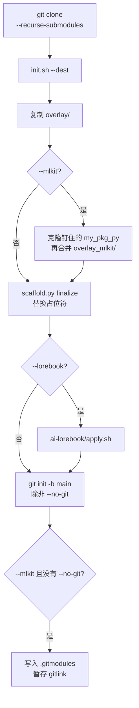

# init.sh

`init.sh` 把 `overlay/` 复制到空目录，换掉占位符，需要时再带上 mlkit 或 AI 编辑器规则。

```bash
./init.sh --dest PATH [--name NAME] [--python VERSION]
           [--mlkit] [--lorebook] [--https] [--no-git]
```

## 参数

| 参数 | 含义 |
| --- | --- |
| `--dest PATH` | 新项目目录。必填。路径不存在时会创建。已经存在则必须是空目录。 |
| `--name NAME` | 项目名。默认是目标目录的最后一段。 |
| `--package PKG` | 覆盖导入包名。默认把 `NAME` 里的 `-` 和 `.` 换成 `_`。 |
| `--python VERSION` | Python 版本。默认 `3.12`。 |
| `--mlkit` | 把钉住的 `my_pkg_py` 子模块克隆到 `pkgs/`，并搭上训练流水线。没传 `--no-git` 时，把这次检出登记为新项目的 submodule。 |
| `--lorebook` | 复制 Cursor、Copilot 和 Claude 的规则。默认关闭。 |
| `--https` | `pkgs/my_pkg_py` 的 origin 使用 HTTPS。登记了 submodule 时，`.gitmodules` 里的 URL 同样改写。模板自己的 `origin` 已经是 `http://` 或 `https://` 时也会改写。 |
| `--no-git` | 不在目标目录执行 `git init`。带了 `--mlkit` 时，pin 不会记下来。 |
| `-h`、`--help` | 打印注释里的帮助并退出。 |

## 名字

- 项目名：以字母或数字开头和结尾，中间还可以有 `.`、`_`、`-`。例如 `my-exp`。平时只传 `--name`；省略时用目标目录的最后一段。
- 包名：Python 标识符，由字母、数字和 `_` 组成，不能以数字开头。由项目名把 `-` 和 `.` 换成 `_` 得到，所以 `my-exp` 和 `my.exp` 都导入为 `my_exp`。导入名要另起时才传 `--package`，例如 `--name acme-lab --package lab`。
- Python 版本：`主版本.次版本` 或 `主版本.次版本.补丁`，例如 `3.12` 或 `3.12.1`。

版本号还会推出两个值：

- `__PYTHON_TAG__` 是 `py` 加上主版本和次版本。`3.12.1` 得到 `py312`。
- `__PYTHON_NEXT__` 是下一个次版本。`3.12` 和 `3.12.1` 都得到 `3.13`。

版本为 3.12 时，生成的 `requires-python` 是 `>=3.12,<3.13`。上界是下一个次版本，不包含该版本。

## 顺序



1. 缺少 `--dest`、路径不是目录、或目录里已经有文件，就退出。
2. `PATH` 上要能找到 `uv`。
3. 把 `overlay/` 复制到目标目录。
4. 带了 `--mlkit` 时，把本仓库的 `my_pkg_py` 检出克隆到 `pkgs/my_pkg_py`，把这次克隆 detach 到模板 pin，再把 `overlay_mlkit/` 盖上去。克隆的提交和 pin 对不上就退出。
5. 把 `src/__PACKAGE_NAME__` 改名为 `src/<package>`。
6. 跑 `scaffold.py finalize`：替换占位符。带 `--mlkit` 时还改 `pyproject.toml`，并在 `README.md` 末尾加上 mlkit 说明。接下来会 `git init` 时，finalize 还带 `--track-mlkit`：不再忽略 `pkgs/my_pkg_py`，README 里改成 submodule 说明。
7. 带 `--lorebook` 时，跑 `ai-lorebook/apply.sh -d DEST -f`。
8. 给 shell 脚本加上可执行权限。
9. 没传 `--no-git` 就执行 `git init -b main`。带了 `--mlkit` 时，用克隆的 origin 写 `.gitmodules`，把 `pkgs/my_pkg_py` 的 gitlink 按 pin 暂存，再跑 `git submodule absorbgitdirs`。`--no-git` 保留本地克隆，并警告 pin 不会记进这个仓库。

## 占位符

目标目录里的文本文件会换掉这些字符串：

| 占位符 | 替换成 |
| --- | --- |
| `__PROJECT_NAME__` | `--name` |
| `__PACKAGE_NAME__` | 导入包名（`--package`，否则由 `--name` 推导） |
| `__PYTHON_VERSION__` | `--python` |
| `__PYTHON_TAG__` | `py` + 主版本 + 次版本 |
| `__PYTHON_NEXT__` | 下一个次版本 |

按字面字符串替换。非法 UTF-8 的文件跳过。名为 `.git`、`.venv`、`__pycache__` 的目录跳过。带 `--mlkit` 时 `pkgs/` 也跳过，克隆下来的库保持原文。

## HTTPS 远程地址

`--mlkit` 把新克隆的 `origin` 设成模板 `.gitmodules` 里的子模块 URL（文件没另写时是 `git@github.com:zeroDtree/my_pkg_py.git`）。新项目登记 submodule 时，自己的 `.gitmodules` 记下同一个 URL。

下面任一成立，这个 URL 就改成 HTTPS：

- 传了 `--https`
- 模板仓库自己的 `origin` 已经以 `http://` 或 `https://` 开头

`git@host:path` 和 `ssh://git@host/path` 变成 `https://host/path`。本来就是 HTTP 或 HTTPS 的地址保持原样。
