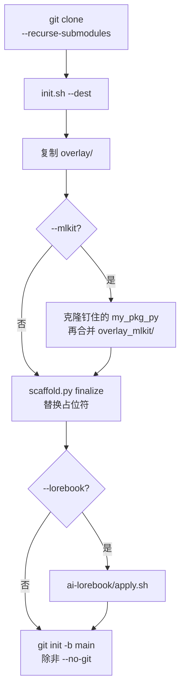

# init.sh

`init.sh` 把 `overlay/` 复制到一个空目录，替换占位符，并按需加上 mlkit 或 AI 编辑器规则。

```bash
./init.sh --dest PATH [--name NAME] [--package PKG] [--python VERSION]
           [--mlkit] [--lorebook] [--https] [--no-git]
```

## 参数

| 参数 | 含义 |
| --- | --- |
| `--dest PATH` | 新项目目录。必填。路径不存在时会创建。已经存在则必须是空目录。 |
| `--name NAME` | 项目名。默认是目标目录的最后一段。 |
| `--package PKG` | 导入用的包名。默认把 `NAME` 里的 `-` 换成 `_`。 |
| `--python VERSION` | Python 版本。默认 `3.12`。 |
| `--mlkit` | 把钉住的 `my_pkg_py` 子模块克隆到 `pkgs/`，并搭上训练流水线。 |
| `--lorebook` | 复制 Cursor、Copilot 和 Claude 的规则。默认关闭。 |
| `--https` | `pkgs/my_pkg_py` 的 origin 使用 HTTPS。模板自己的 `origin` 已经是 `http://` 或 `https://` 时也会改写。 |
| `--no-git` | 不在目标目录执行 `git init`。 |
| `-h`、`--help` | 打印注释里的帮助并退出。 |

## 合法的名字

- 项目名：以字母或数字开头和结尾，中间还可以有 `.`、`_`、`-`。例如 `my-exp`。
- 包名：Python 标识符，由字母、数字和 `_` 组成，不能以数字开头。例如 `my_exp`。
- Python 版本：`主版本.次版本` 或 `主版本.次版本.补丁`，例如 `3.12` 或 `3.12.1`。

脚本还会从版本号推出两个值：

- `__PYTHON_TAG__` 是 `py` 加上主版本和次版本。`3.12.1` 得到 `py312`。
- `__PYTHON_NEXT__` 是下一个次版本。`3.12` 和 `3.12.1` 都得到 `3.13`。

版本为 3.12 时，生成的 `requires-python` 是 `>=3.12,<3.13`。上界是下一个次版本，并且不包含该版本。

## 脚本做了什么



顺序如下：

1. 拒绝缺少 `--dest`、路径不是目录、或目录里已经有文件。
2. 要求 `PATH` 上能找到 `uv`。
3. 把 `overlay/` 复制到目标目录。
4. 带了 `--mlkit` 时，把本仓库的 `my_pkg_py` 检出克隆到 `pkgs/my_pkg_py`，再把 `overlay_mlkit/` 覆盖上去。克隆得到的提交会和子模块的 pin 比对。
5. 把 `src/__PACKAGE_NAME__` 改名为 `src/<package>`。
6. 运行 `scaffold.py finalize`：替换占位符；带了 `--mlkit` 时还会改 `pyproject.toml`，并在 `README.md` 末尾加上 mlkit 说明。
7. 带了 `--lorebook` 时，运行 `ai-lorebook/apply.sh -d DEST -f`。
8. 给 shell 脚本加上可执行权限。
9. 除非 `--no-git`，否则执行 `git init -b main`。

## 占位符

目标目录里的文本文件会替换这些字符串：

| 占位符 | 替换成 |
| --- | --- |
| `__PROJECT_NAME__` | `--name` |
| `__PACKAGE_NAME__` | `--package` |
| `__PYTHON_VERSION__` | `--python` |
| `__PYTHON_TAG__` | `py` + 主版本 + 次版本 |
| `__PYTHON_NEXT__` | 下一个次版本 |

替换是按字面字符串进行的。不是合法 UTF-8 的文件会跳过。名为 `.git`、`.venv`、`__pycache__` 的目录会跳过。带了 `--mlkit` 时还会跳过 `pkgs/`，因此克隆下来的库保留自己的原文。

## HTTPS 远程地址

`--mlkit` 把新克隆的 `origin` 设为 `.gitmodules` 里的子模块 URL（文件没另写时是 `git@github.com:zeroDtree/my_pkg_py.git`）。

下面任一成立时，这个 URL 会改写成 HTTPS：

- 传了 `--https`
- 模板仓库自己的 `origin` 已经以 `http://` 或 `https://` 开头

`git@host:path` 和 `ssh://git@host/path` 会变成 `https://host/path`。本来就是 HTTP 或 HTTPS 的地址保持不变。没有 `--mlkit` 时，`--https` 不会改任何远程地址，因为只有 mlkit 的克隆会设置这个 remote。
